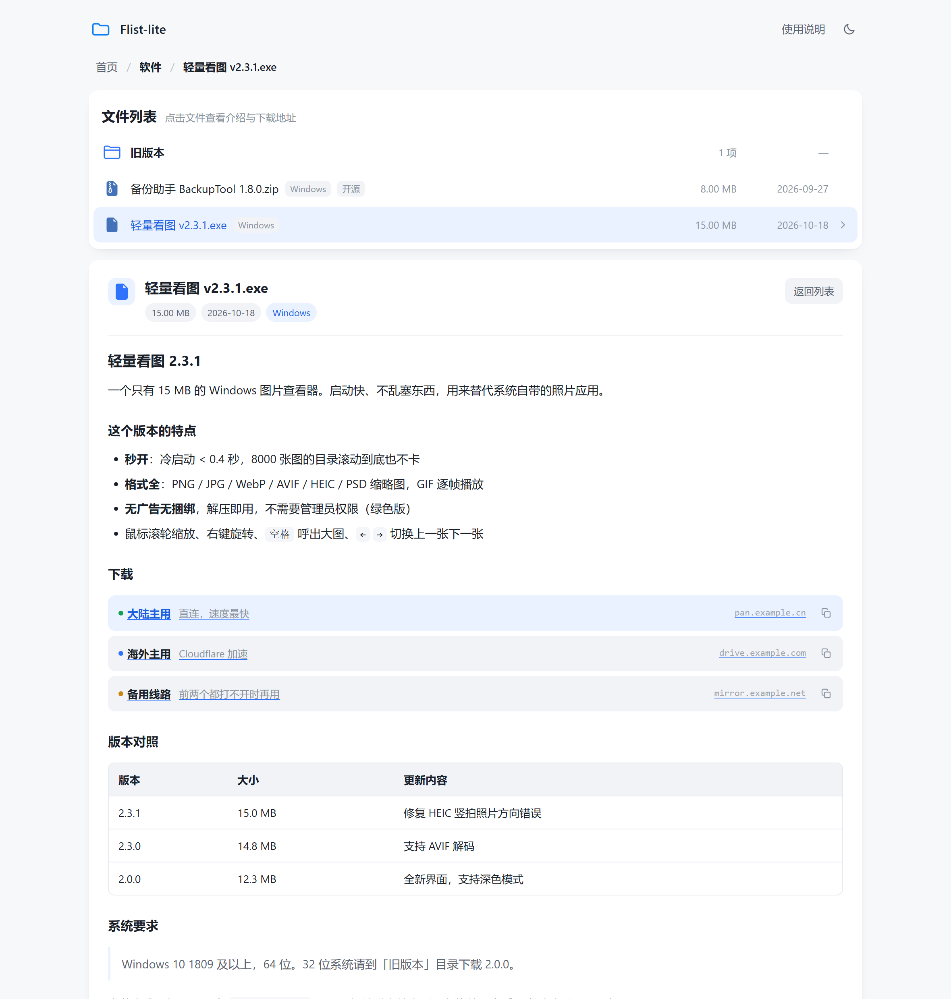
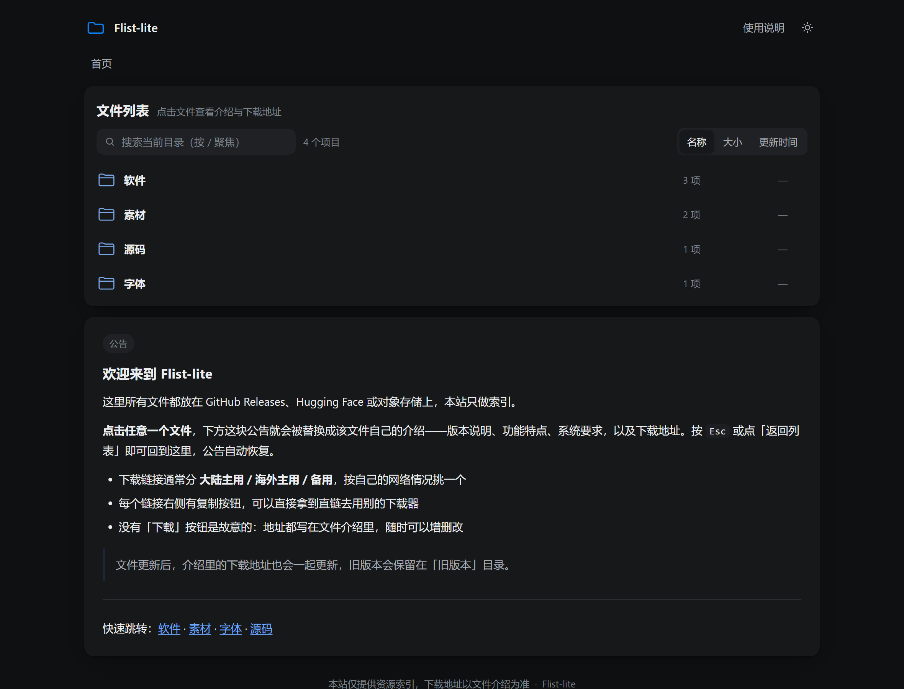
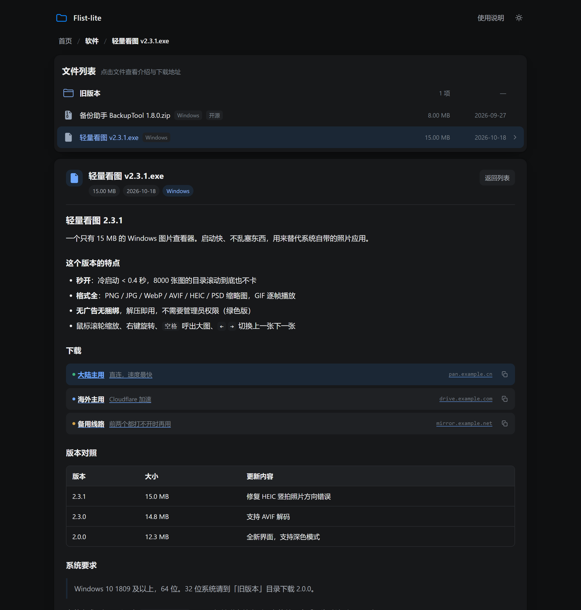
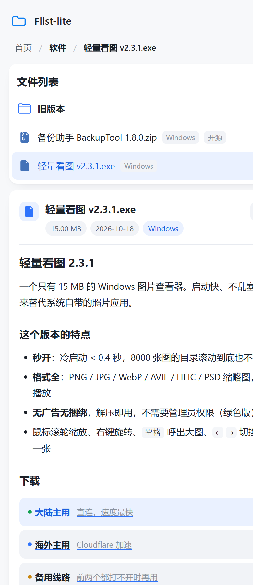

# Flist-lite

一个类似 [FList](https://github.com/jianjianai/FList) 的文件列表站，为 Cloudflare Pages 量身定制。

**核心区别：没有「下载」按钮。** 点开一个文件，列表下方会出现**这个文件自己的介绍**（取代全局公告）；介绍里写功能特点，并用一种简单的语法列出多条下载地址（大陆主用 / 海外主用 / 备用……想放几条放几条）。点「返回列表」或按 `Esc`，公告自动回来。

纯静态、零依赖、零构建：改 `data/` 里的两个 JSON 和几个 `.md`，刷新页面就生效。

---

## 预览

| 首页 + 全局公告（浅色） | 点开文件 → 独立介绍（浅色） |
| --- | --- |
|  |  |

| 首页（深色主题） | 点开文件 → 独立介绍（深色） |
| --- | --- |
|  |  |

| 移动端（390 × 900） | |
| --- | --- |
|  | |

---

## 它做了什么

- **文件独立介绍**：每个文件一篇 Markdown，点开即替换列表下方的全局公告，返回后公告复现
- **无内置下载**：列表里点文件只是打开介绍，真正的下载地址写在介绍里，随时可增删改
- **多线路下载块**：` ```links ` 语法，一行一条，自动挑出主链接并高亮，其余按大陆绿 / 海外蓝 / 备用橙区分，带「复制直链」按钮
- **完整 Markdown**：标题、表格、代码块、引用、列表、任务列表、图片、脚注式排版
- **好用的小东西**：搜索过滤、按名称/大小/时间排序、深浅色主题、移动端适配、键盘快捷键（`/` 搜索、`Esc` 返回）
- **单色文件图标**：和 [OpenList](https://github.com/OpenListTeam/OpenList) 前端同一套 —— [Bootstrap Icons](https://github.com/twbs/icons) 的 file-earmark 系列 + [Ionicons](https://github.com/ionic-team/ionicons) 的文件夹（都是 MIT），全部文件共用一档灰蓝，只有文件夹换一档亮蓝
- **对 Cloudflare 友好**：没有构建步骤，没有 Node 依赖，`_headers` 里已经配好安全头和缓存策略

## 和原版 FList 的差别

| | 原版 FList | 这个项目 |
| --- | --- | --- |
| 技术栈 | VuePress 2 + Vue，需要 Node 构建 | 原生 JS + CSS，**无构建** |
| 文件来源 | 构建时抓 GitHub Releases / HF / Gitee / URL 树 | 手写 `data/files.json`（链接照样指向 GitHub、HF、网盘） |
| 文件介绍 | 只有列表下方一块全局 Markdown | **每个文件一篇**，打开时替换公告 |
| 下载 | 每个文件页有内置下载按钮 | **去掉下载按钮**，地址写在介绍里 |
| 部署 | Cloudflare Pages 需要装依赖 + 构建 | 直接把目录传上去 |

如果你的文件都在 GitHub Releases，想让脚本自动同步，可以再写个小工具生成 `files.json`——数据格式很简单，见下文。

## 快速开始

```bash
cd flist-lite
node tools/dev.mjs          # → http://127.0.0.1:8080
```

> 必须用一个 HTTP 服务打开。直接双击 `index.html` 会因为 `file://` 安全策略读不到 `data/*.json`。

## 目录结构

```text
flist-lite/
├─ index.html              页面骨架
├─ assets/
│  ├─ style.css            全部样式（浅色 / 深色主题、响应式）
│  ├─ theme.js             首屏主题（避免深色用户刷新闪白）
│  ├─ app.js               路由、列表渲染、文件介绍面板
│  ├─ markdown.js          Markdown 渲染器（含 ```links 语法）
│  ├─ icons.js             文件类型图标（内联 SVG）
│  ├─ icon-paths.js        图标路径数据（从 Bootstrap Icons / Ionicons 抽取）
│  └─ logo.svg             站点图标 / favicon
├─ data/
│  ├─ site.json            站点名、页脚、公告路径、页头链接
│  ├─ files.json           文件清单（目录树）
│  ├─ announcement.md      全局公告
│  └─ notes/               每个文件的介绍，一篇一个 .md
├─ tools/
│  ├─ dev.mjs              本地预览服务器
│  ├─ check.mjs            清单 / 介绍文件校验
│  └─ selftest.mjs         Markdown 渲染器自测
├─ _headers                Cloudflare Pages 安全头与缓存策略
├─ LICENSE                 许可协议正文（非商业相同方式共享 1.0）
├─ NOTICE                  版权声明与第三方组件说明
└─ README.md
```

## 添加一个文件（三步）

**1. 写介绍**：新建 `data/notes/我的软件.md`

````markdown
## 我的软件 1.2.0

一句话说明它解决什么问题。

### 特点

- 启动快，体积小
- 支持 Windows / macOS

### 下载

```links
大陆主用 | https://pan.example.cn/d/myapp-1.2.0 | 直连，速度最快
海外主用 | https://github.com/you/myapp/releases/download/v1.2.0/myapp.zip | GitHub Releases
备用线路 | https://mirror.example.net/myapp-1.2.0.zip | 前两个打不开时用
```
````

**2. 登记文件**：在 `data/files.json` 对应的目录里加一条

```json
{
  "name": "我的软件 1.2.0.zip",
  "size": 45088768,
  "date": "2026-10-20",
  "tags": ["Windows", "免费"],
  "note": "notes/我的软件.md"
}
```

**3. 刷新页面**。就这样，不需要构建。

## 文件清单字段

| 字段 | 类型 | 说明 |
| --- | --- | --- |
| `name` | string | **必填**，显示的文件名（带扩展名，图标据此判断） |
| `type` | string | `"folder"` 表示目录，可省略（有 `children` 也算目录） |
| `children` | array | 目录内容，结构与本数组相同 |
| `size` | number | 字节数，会格式化成 KB / MB / GB |
| `date` | string | `YYYY-MM-DD`，或 `2026-10-20T12:00:00Z` 这类时间戳 |
| `tags` | string[] | 文件后面的小标签，最多显示 2 个 |
| `note` | string | 介绍文件路径，相对 `data/`，如 `notes/xxx.md` |
| `noteText` | string | 也可以直接把 Markdown 写在这里（适合很短的说明） |

> 目录本身不需要 `note`；文件没有 `note` 时会显示一段「如何添加介绍」的提示。

## 下载链接块

在介绍里写一个语言标记为 `links` 的代码块，一行一条链接：

````text
```links
名称 | 链接 | 备注
大陆主用 | https://cn.example.com/a | 直连
海外主用 | https://us.example.com/a
备用线路 | https://mirror.example.com/a | 兜底
# 以 # 开头的行是注释
```
````

规则：

- 竖线分隔三列，**备注可省略**；也可以只写一个链接，名称会自动取域名
- 条数不限，渲染成一张竖排列表，十几条也不会挤
- 颜色只用来表达「线路性质」，**同一个文件里不会重复**：名字或备注含「大陆 / 国内 / 直连」→ 绿色圆点，「海外 / 国外 / 境外」→ 蓝色圆点，「备用 / 镜像 / 备份」→ 橙色圆点，其余→灰点。想加多少条、加多少「未分类」的条目，都只是多几行灰点，不会撞色
- 整个文件里**只有一条会被高亮成主链接**（左侧一道浅蓝底 + 主色文字 + 域名）：名字或备注里写了「主用 / 主链 / 推荐 / 首选 / primary / main」的那条优先；一条都没写就默认第一条
- 如果你自己写了「主用」字样，就不再多加一个「主」标签；没写时高亮那条前面会补一个「主」标签，说明它为什么被高亮
- 每条右侧有复制按钮，方便复制直链去 IDM / aria2 里用；手机上自动隐藏域名列，只留「名称 + 备注」

## Markdown 支持范围

支持：标题 `#`~`######`、段落与换行、`**粗体**`、`*斜体*`、`~~删除线~~`、`行内代码`、围栏代码块（带语言高亮类名）、链接、图片、裸链接自动识别、无序 / 有序列表（可嵌套、支持 `- [x]` 任务列表）、引用 `>`、分割线 `---`、表格（支持 `:---:` 对齐）、以及上面的 ` ```links ` 块。

不支持：直接写原始 HTML（会被转义，防止注入）、脚注、公式。

> 链接只放行 `http` / `https` / `mailto` / `tel` 和站内相对路径，`javascript:` 一律丢弃。

## 部署到 Cloudflare Pages

**方式 A：网页上传（最省事）**

1. Cloudflare Dashboard → **Workers & Pages** → **Create** → **Pages** → **Upload assets**
2. 把整个 `flist-lite` 文件夹拖进去（或先压成 zip；`.shots/`、`.git/` 之类不用传）
3. Deploy → 得到 `https://<项目名>.pages.dev`

**方式 B：命令行**

```bash
npx wrangler pages deploy . --project-name flist-lite
```

首次运行会要求登录 Cloudflare（浏览器授权）。

**方式 C：接 GitHub 自动部署**

把这个目录推到 GitHub 仓库，然后在 Pages 里 **Connect to Git**：框架预设选 `None`，**Build command 留空**，**Build output directory 填 `/`**。之后每次 push 自动上线，等于把这个仓库当内容管理系统用。

其它补充：

- **自定义域名**：Pages 项目 → Custom domains，按提示加一条 CNAME
- **缓存**：`_headers` 里给 `data/*` 设了 60 秒缓存，改完内容最多一分钟生效；想立刻生效就在 Dashboard 里 Purge Cache
- **安全头**：`_headers` 里已经带了 CSP、nosniff、Referrer-Policy 等；如果你往介绍里嵌了外链图片，`img-src` 已经放行 `https:`

## 校验与自测

改完内容跑一下，能提前发现漏写的介绍、重复的文件名、空的下载块：

```bash
node tools/check.mjs      # 校验 data/ 内容
node tools/selftest.mjs   # 跑 Markdown 渲染器与图标自测（47 项）
```

## 一些定制点

- **站点信息**：`data/site.json` 里的 `name` / `title` / `description` / `footer` / `links` / `logo`
- **配色**：`assets/style.css` 顶部两组 CSS 变量（`:root` 是浅色，`[data-theme="dark"]` 是深色），改 `--accent` 就能换主色
- **强制主题**：访问 `?theme=dark` 或 `?theme=light` 可以覆盖系统主题（方便分享和截图，不会写进访问者的本地存储）
- **公告**：`data/announcement.md`，留空则整块公告不显示

## 常见问题

**双击 `index.html` 一片空白？**
浏览器不允许 `file://` 下用 `fetch` 读本地 JSON。用 `node tools/dev.mjs` 或任意静态服务器。

**介绍里想放截图？**
把图片放到 `assets/`（比如 `assets/screenshots/a.png`），在 Markdown 里写 `` 或 `/assets/screenshots/a.png`；外链图片用完整 `https://` 地址也能显示。相对路径是相对站点根目录，不是相对 `.md` 文件。

**文件名里有空格或中文会有问题吗？**
不会，链接会自动做 URL 编码，从浏览器地址栏复制出去的分享链接也能正常打开。

**能不能连 GitHub Releases 自动同步？**
可以加一个 Node 脚本，调 `https://api.github.com/repos/{owner}/{repo}/releases` 生成 `files.json` 条目；本项目故意没内置，避免部署时联网失败。数据格式见上表。

## 授权

本项目按《Flist-lite 非商业相同方式共享许可协议 1.0》（Flist-lite Non-Commercial Share-Alike License 1.0）发布。协议全文见 `LICENSE`（中文为唯一具法律效力的文本，附录 B 的英文译文仅供参考）；版权行、原创范围与第三方组件声明见 `NOTICE`。

**这不是 OSI 定义的开源协议。** 它属于「源码公开可得（source-available）+ 非商业 copyleft」：非商业用途可以自由使用、修改、再分发；商业用途须另行取得书面授权；衍生作品必须沿用同一协议并公开对应源代码。

### 关于法律效力

本协议是一份著作权许可合同，不是法律意见，也不是经律师审阅的标准文本。它把「非商业 + 署名 + 相同方式共享 + 提供对应源代码」写成可主张的条款，并明确了接受方式（第 0.6 条）与许可期间（第 2.5 条），因此并非没有约束力；但「非商业」的边界、责任限制（第 5.3 条）等条款在不同法域可能有不同解释，跨境维权另有成本。若需要更强的确定性——例如实际收取商业授权费、或遇到侵权纠纷——建议请执业律师审阅，并依第 4.1 条另行准备商业授权文本。第 7.8 条已约定适用法律与争议解决方式，可一并确认。

### 五条约束的落点

| 规则 | 协议条款 |
| --- | --- |
| 不可商用 | 第 1.4 条定义非商业用途（(a)–(e) 属于非商业，(f)–(j) 视为商业）；第 2.1 条授予范围仅限非商业；第 4.1 条商业使用须另行书面授权 |
| 可以修改 | 第 2.1(c) 条 |
| 可以二次分发 | 第 2.1(d) 条，第 1.5 条定义「分发」 |
| 必须署名 | 第 3.1 条规定四类展示位置，且不得暗示原作者为衍生作品背书；附录 A 提供文字、页脚 HTML、文件头注释三种可直接复制的样板 |
| 衍生作品必须开源 | 第 3.2 条相同方式共享；第 3.3 条源代码可得（以线上服务形式提供时，也须在显著位置给出源码链接）；第 3.4 条随附协议全文与 `NOTICE`；第 3.5 条标注修改过的文件；第 3.6 条不得施加额外限制 |

专利：第 4.2 条授予非商业范围内的专利许可，并附专利报复条款（就本项目提起专利诉讼的，许可自起诉之日终止）；商业场景的专利授权须依第 4.1 条另行取得。第 4.3 条不授予「Flist-lite」名称与商标使用权。

### 与常见协议的差别

| 候选协议 | 不合用的地方 |
| --- | --- |
| CC BY-NC-SA 4.0 | 面向文字、图像一类内容，没有「源代码」概念，也未规定以目标形式分发时如何提供可重建的源码——而纯静态站最常见的再分发形态正是合并压缩后的 `assets/*.js` 或一个线上部署的站点，恰是它覆盖不到的情形；此外没有专利条款 |
| PolyForm Noncommercial 1.0.0 | 非商业限制到位，但没有相同方式共享要求，衍生作品可以闭源分发 |
| Apache-2.0 / MIT | 允许商业使用，与「不可商用」直接冲突 |

自定义本协议，是为了把「非商业 + 必须署名 + 衍生作品同协议 + 提供对应源代码（含线上服务场景）+ 标注修改 + 不得额外限制」写进同一份文本，并补齐专利、免责与终止恢复条款。条款间的关系与版本规则见第 7.1、7.2、7.5 条。

### 版权行

`NOTICE` 中的版权行为：

```text
Copyright 2026 YGPTDR-web (https://github.com/YGPTDR-web)
```

修改时的格式约定：

- 保留 `Copyright` 一词；年份写**首次发布**的年份即可，跨年开发可写作 `2025-2026`；
- 署名可用 GitHub ID、真名，或 `真名 (@GitHubID)`；
- 不要写尚未取得的法人主体名称（例如尚未注册的公司），取得后再补一行；
- 想署仓库地址，可在版权行下方另起一行写 `本项目：Flist-lite https://github.com/YGPTDR-web/flist-lite`。

若以本协议发布自己的衍生作品，除改写 `NOTICE` 的版权行外，还须同步修改 `LICENSE` 第 1.9 条中的许可人名称与主页，其余条款无需改动。

### 第三方组件

| 组件 | 用途 | 授权 |
| --- | --- | --- |
| [Bootstrap Icons](https://github.com/twbs/icons) 1.11.3 | `assets/icon-paths.js` 中 13 个文件类型图标 | MIT |
| [Ionicons](https://github.com/ionic-team/ionicons) 8.1.0 | `assets/icon-paths.js` 中的文件夹图标 | MIT |

这两个组件依其原本的 MIT 协议分发，**不受本项目协议约束**，也允许商业使用；其版权声明与许可全文保留在 `NOTICE` 中，见本协议第 7.9 条。除此之外没有任何第三方运行时依赖：没有 npm 包、没有 CDN 脚本、没有外部字体，`assets/*` 与 `assets/style.css` 均为原创。

### 与 AGPL-3.0 项目的边界

[OpenList](https://github.com/OpenListTeam/OpenList) 服务端与 [AList](https://github.com/alist-org/alist) 均以 **AGPL-3.0** 发布。本项目只是在图标选型上与 OpenList 前端使用了同一套图标库（Bootstrap Icons / Ionicons，均为 MIT），未复制其任何代码或图标文件，因此可以按本协议发布。若后续引入 OpenList / AList 的代码，整站须改为 AGPL-3.0 并公开源代码——AGPL-3.0 与本协议不兼容（见 `LICENSE` 第 7.9 条）。

### 商业授权

商业用途（含企业内部支撑营收的业务系统、付费服务、广告变现、有偿托管等，详见第 1.4 条 (f)–(j)）须事先取得书面授权。请求渠道：仓库 Issue 或版权行中的联系方式。
